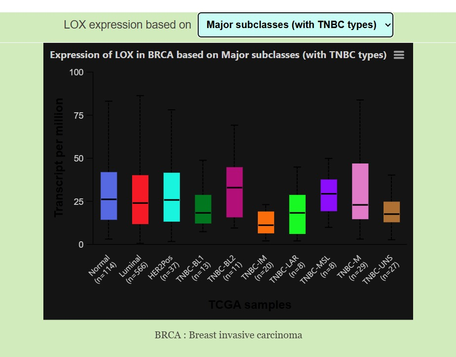
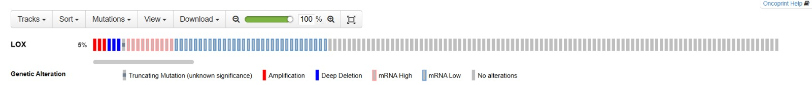
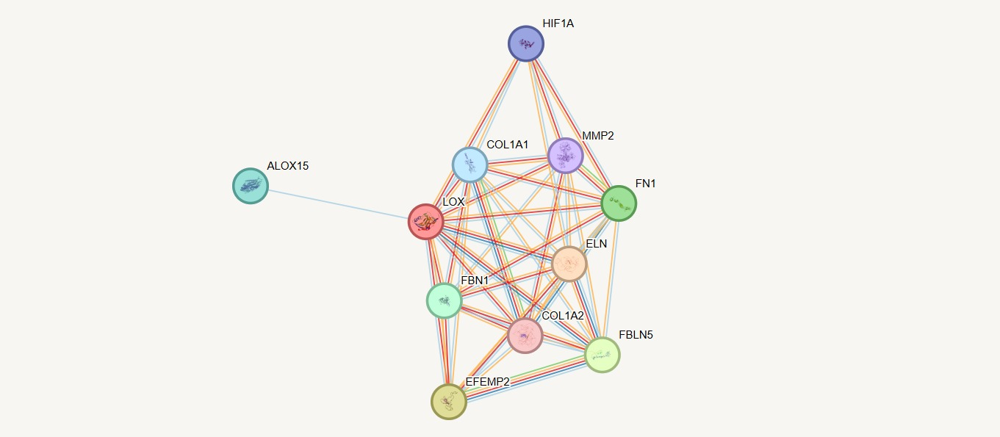

# LOX in Breast Cancer — Integrated Mechanistic Evidence Analysis

**Research focus:** Lysyl oxidase (LOX), extracellular matrix remodeling, and chemotherapy resistance in breast cancer.

## Research Question

Does LOX contribute to chemotherapy resistance by modifying the extracellular matrix (ECM) surrounding breast cancer cells?

This project integrates public cancer genomics databases, functional protein networks, and published experimental evidence to investigate this question.

## Research Workflow

**Biological Question → Gene Expression → Coexpression → Genomic Alterations → Functional Network → Experimental Evidence → Conclusion**

| Tool | Investigation |
|---|---|
| UALCAN | Where and how strongly is LOX expressed? |
| UALCAN Coexpression | Which genes show similar expression patterns? |
| cBioPortal | How frequently is LOX altered? |
| STRING | Which biological proteins are functionally associated with LOX? |
| Published experiments | Does manipulating LOX change chemotherapy resistance? |

## 1. UALCAN — LOX Expression Across Breast Cancer Subtypes

**Observation:** LOX expression varies across breast cancer subtypes. In the overall tumor-versus-normal comparison, the reported p-value was 0.2782, indicating no statistically significant difference.

The TNBC immunomodulatory subgroup showed relatively low LOX expression in the examined subtype comparisons.

**Interpretation:** LOX is not universally overexpressed in breast cancer. Its expression depends on biological context.

## 2. UALCAN — LOX Coexpression

We investigated which genes exhibit expression patterns correlated with LOX.

| Gene | Pearson correlation |
|---|---:|
| COL5A2 | 0.82 |
| FBN1 | 0.81 |
| LUM | 0.80 |
| DACT1 | 0.80 |
| FSTL1 | 0.80 |

**Observation:** Several strongly correlated genes are associated with extracellular matrix organization.

**Interpretation:** LOX expression tracks an ECM-related transcriptional program, although correlation alone does not establish causality.

**[View the LOX coexpression dataset](data/LOX_correlated_genes.txt)**

## 3. cBioPortal — LOX Genomic Alterations

**Dataset:** Breast Invasive Carcinoma (TCGA, PanCancer Atlas).

**Analyzed samples:** 994.

**Observation:** LOX was reported as altered in 49 samples, approximately 5% of the selected cohort.

The analysis included mutations, structural variants, copy-number alterations, and mRNA expression outliers at a z-score threshold of ±2.

**Interpretation:** The observed alteration frequency includes expression outliers and must not be interpreted as the LOX DNA mutation frequency.

## 4. STRING — LOX Functional Association Network

**Organism:** Homo sapiens.

The network identified functional associations between LOX and multiple extracellular matrix-related proteins.

| Protein | STRING score |
|---|---:|
| ELN | 0.998 |
| EFEMP2 | 0.982 |
| FBLN5 | 0.979 |
| FN1 | 0.953 |
| FBN1 | 0.928 |
| COL1A1 | 0.828 |
| HIF1A | 0.816 |
| MMP2 | 0.811 |

**Interpretation:** These associations support LOX's functional involvement in ECM organization and remodeling. STRING associations do not necessarily represent direct physical binding or cancer-specific causation.

## 5. Published Experimental Evidence

### Primary Research Paper

**Targeting lysyl oxidase (LOX) overcomes chemotherapy resistance in triple negative breast cancer.**

*Nature Communications* (2020).

**[Read the published paper](https://www.nature.com/articles/s41467-020-16199-4)**

The researchers investigated how manipulating LOX influences chemotherapy response in experimental TNBC models.

Their experiments support a causal contribution of LOX to chemotherapy resistance under specific biological conditions.

These published experiments provide stronger causal evidence than our observational database analyses.

## 6. Integrated Mechanistic Interpretation

The evidence supports the following proposed pathway:

**LOX activity → Collagen crosslinking → ECM structural changes → Altered drug penetration and cell-survival signaling → Chemotherapy resistance**

This mechanism is supported by published preclinical experiments. Our database results provide complementary molecular and functional context rather than independent proof of the mechanism.

## 7. Key Findings

1. LOX expression varies across breast cancer contexts.
2. LOX correlates with multiple ECM-associated genes.
3. LOX alterations or expression outliers were detected in approximately 5% of the selected TCGA cohort.
4. STRING supports functional associations between LOX and ECM-related proteins.
5. Published experimental interventions support a context-dependent causal contribution of LOX to chemotherapy resistance.

## 8. Limitations

- The database analyses were exploratory.
- No new wet-lab experiments were performed.
- Gene coexpression does not establish causality.
- Stromal abundance may influence LOX expression patterns.
- The genomic cohort includes multiple breast cancer subtypes.
- Preclinical evidence does not establish clinical effectiveness of LOX inhibition.

## 9. Conclusion

This integrated evidence assessment supports **LOX as a context-dependent contributor to ECM-associated chemotherapy resistance in experimental breast cancer models**, particularly TNBC.

The project demonstrates a research workflow combining gene expression, genomic alterations, functional networks, and published causal experiments.

It is an evidence-based mechanistic investigation, not a claim of a newly discovered cancer mechanism.

## Data Sources and References

- [UALCAN](https://ualcan.path.uab.edu/)
- [cBioPortal](https://www.cbioportal.org/)
- [STRING](https://string-db.org/)
- [Nature Communications — LOX and chemotherapy resistance in TNBC (2020)](https://www.nature.com/articles/s41467-020-16199-4)

**Project status:** Completed exploratory evidence assessment.
